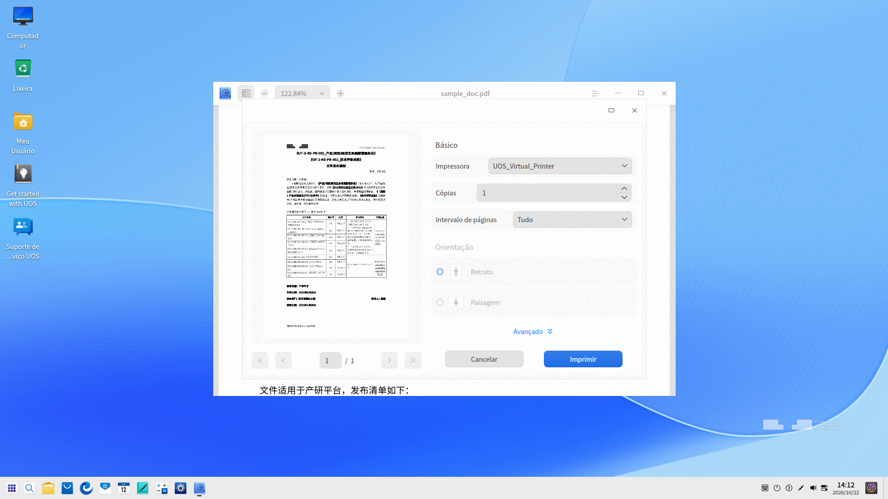
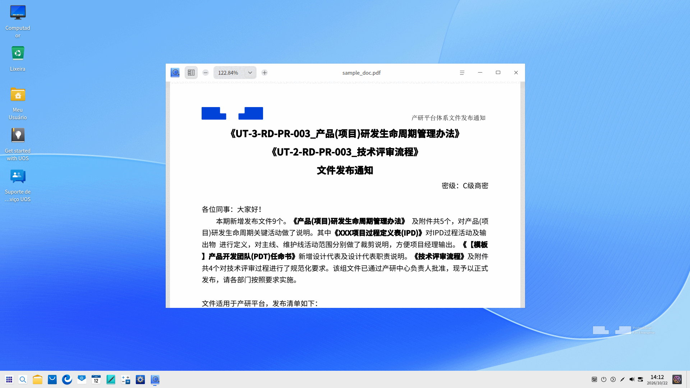

# Visualizador de Documentos|deepin-reader|

## Visão Geral

O Visualizador de Documentos é um software poderoso e fácil de usar integrado ao sistema para abrir e visualizar arquivos com rapidez, com suporte a operações como adição de marcadores, notas de anotação e destaque de texto.

## Guia

Você pode executar, fechar ou criar um atalho para o Visualizador de Documentos das seguintes formas:

### Executar o Visualizador de Documentos

1. Clique em  no Dock para abrir a interface do Iniciador.
2. Localize  rolando a roda do mouse ou pesquisando por "Visualizador de Documentos" no Iniciador e clique nele para executar.
3. Clique com o botão direito em  para:

 - Selecionar **Enviar para a área de trabalho** para criar um atalho na área de trabalho.
 - Selecionar **Fixar no dock** para fixá-lo no Dock.
 - Selecionar **Adicionar à inicialização** para que o aplicativo seja executado automaticamente ao iniciar o computador.

### Sair do Visualizador de Documentos

- Na interface do Visualizador de Documentos, clique em  para sair. 
- Clique com o botão direito em  no Dock e selecione **Fechar tudo** para sair.
- Na interface do Visualizador de Documentos, clique em  e selecione **Sair**.

### Exibir Teclas de Atalho

Na interface do Visualizador de Documentos, pressione **Ctrl + Shift + ?** para visualizar todos os atalhos de teclado, ajudando a usá-los com habilidade e aumentando sua eficiência.

## Funções Básicas

O Visualizador de Documentos realiza o gerenciamento básico de documentos, como abertura, salvamento e impressão de arquivos, bem como o controle de abas, marcadores e anotações.

### Abrir Arquivos

O Visualizador de Documentos suporta os formatos PDF, DJVU, DOCX, XPS e OFD. Você pode abrir um arquivo das seguintes maneiras:

- Arrastando o arquivo diretamente para dentro da janela ou sobre o ícone do aplicativo.
- Clicando com o botão direito no arquivo e selecionando **Abrir com** > **Visualizador de Documentos**. Após definir o Visualizador de Documentos como o aplicativo padrão, você poderá abri-lo dando um clique duplo diretamente.
- Clicando em **Selecionar Arquivo** na tela inicial do Visualizador de Documentos.
- Na interface do Visualizador de Documentos, pressionando **Ctrl + O** e selecionando o arquivo que deseja abrir.

>  Notas: 
> - O formato OFD (Open Fixed-layout Document) suporta visualização básica, zoom, mudança de página e informações do documento. Anotações, destaques, pesquisa e impressão não são suportados no momento.
> - O formato XPS suporta visualização, seleção de texto, pesquisa, mudança de página e impressão.

### Restaurar Posição de Leitura

O Visualizador de Documentos lembra automaticamente o seu estado de leitura, incluindo a última página visualizada, posição de rolagem, proporção de zoom, modo de exibição (página simples/dupla), ângulo de rotação, estado do painel lateral e ordem das abas.

- Ao reabrir um documento visualizado anteriormente, ele restaura automaticamente a última posição de leitura e o estado da interface.
- Assim que o documento é carregado, uma barra informativa aparece no topo da janela: "Restaurado para a última posição de leitura, clique para ir para a primeira página". Clique nela para retornar rapidamente à página inicial.
- Quando um documento é renomeado ou movido, o Visualizador de Documentos tenta identificar o arquivo e restaurar o progresso de leitura com base em suas características.

### Salvar Documentos

Para salvar um documento que foi editado ou modificado, você pode:

- Pressionar **Ctrl + S** ou clicar em  > **Salvar**.
- Pressionar **Ctrl + Shift + S** ou clicar em  > **Salvar como**.

### Imprimir Documentos

Para imprimir, conecte e configure previamente uma impressora.

#### Impressão Normal

1. Abra um documento no Visualizador de Documentos, clique com o botão direito e selecione **Imprimir**, ou pressione **Ctrl + P** para abrir a página de pré-visualização.
2. Na interface de pré-visualização, você pode verificar e configurar as páginas a serem impressas.
3. Clique em **Avançado** para definir tamanho do papel, método de impressão e outros parâmetros.
4. Clique em **Imprimir** e o documento será enviado para a impressora.

#### Impressão em Lote

Você pode imprimir múltiplos documentos pelo Gerenciador de Arquivos com um só clique, sem precisar abri-los individualmente:

1. No Gerenciador de Arquivos, selecione um ou mais documentos a serem impressos (suporta os formatos PDF, DJVU, DOCX e XPS).
2. Clique com o botão direito e selecione **Impressão em lote**.
3. O Visualizador de Documentos processará e enviará os documentos diretamente para a fila de impressão do sistema (CUPS) usando os parâmetros padrão, sem abrir janelas ou telas de pré-visualização.

>  Notas: 
> - **Parâmetros padrão de impressão**: Impressora padrão do sistema, todas as páginas, papel A4, 1 cópia, frente simples, tamanho real, orientação original do documento, modo de cor (converte automaticamente para preto e branco se a impressora suportar apenas monocromático).
> - **Processamento independente de tarefas**: Cada documento corresponde a um trabalho de impressão independente. Lotes múltiplos entram na fila em ordem, sem interrupções mútuas.
> - **Notificações do sistema**: Um banner de notificação do sistema surge no lado direito da tela indicando o progresso. Se a conversão demorar mais de 1 minuto, notificações adicionais de andamento serão enviadas. Após a submissão, você pode acompanhar o status das tarefas no **Gerenciador de Impressoras** do sistema.

### Gerenciar Abas

Nova aba

- Clique em  > **Nova aba** para adicionar uma aba.
- Quando houver duas ou mais abas abertas, o botão  ficará visível; clique nele para criar novas abas.

Para alternar/organizar abas, você pode:

- Arrastar as abas dentro da janela para ajustar a sequência.
- Clicar nos botões  ou  para mover para a esquerda e para a direita.
- Rolar a roda do mouse sobre a barra de abas para alternar entre elas.

Operações entre janelas

- Arraste qualquer aba para fora da janela atual para criar uma nova janela independente.
- Arraste uma aba de uma janela e solte-a dentro de outra janela existente.

### Gerenciar Marcadores

Com um arquivo aberto na interface do Visualizador de Documentos:

- Adicionar marcador:
   - Clique com o botão direito em qualquer página e selecione **Adicionar marcador** para marcar a página.
   - Posicione o cursor no canto superior direito da página até que o ícone  apareça; clique nele para adicionar um marcador à página (o ícone ficará preenchido em azul ).
- Excluir marcador:
   - Clique com o botão direito no marcador e selecione **Remover marcador**.
   - Clique no ícone de marcador colorido  para cancelar/excluir o marcador.

>  Notas: O ícone de marcador aparece apenas quando o cursor se move para a área de marcadores e desaparece ao afastar o cursor. Quando um marcador é adicionado com sucesso, o ícone permanece visível de forma constante.

### Gerenciar Anotações

Com um arquivo aberto na interface do Visualizador de Documentos:

- Adicionar anotação

   - Selecione um trecho de texto usando a ferramenta de seleção, clique com o botão direito e selecione **Adicionar anotação**. O texto selecionado será destacado após a anotação ser adicionada com sucesso.
   - Clique com o botão direito em qualquer área em branco ou no local desejado e selecione **Adicionar anotação**. Um ícone de nota destacada aparecerá.
     
      >  Notas: 
      > - Clicar em uma área vazia fora da caixa de nota sem inserir texto fará com que a anotação não seja criada ou seja excluída automaticamente.
      > - Clicar em uma área vazia após digitar o conteúdo salvará a anotação automaticamente.

- Copiar nota
   - Clique com o botão direito no texto destacado onde há uma anotação e selecione **Copiar**.
   - Clique com o botão direito no ícone da nota e selecione **Copiar**.
   - Abra o painel lateral pelo ícone , clique no ícone de anotações , selecione a nota na lista, clique com o botão direito e selecione **Copiar**.

- Exibir nota  
   1. Passe o cursor sobre o ícone da nota para pré-visualizar o conteúdo.
   2. Clique no ícone da nota para abrir a janela pop-up, onde você poderá visualizar e reeditar o texto.

- Excluir nota 
   - Clique com o botão direito no texto destacado onde adicionou uma nota e selecione **Remover destaque**.
   - Clique com o botão direito no ícone da nota e selecione **Remover anotação**.
   - No catálogo de anotações  na coluna esquerda, selecione uma nota, clique com o botão direito e selecione **Remover anotação**; a nota e o seu conteúdo serão excluídos.

   >  Notas: 
   > + Você pode mover o ícone da nota dentro da página atual.
   > + Não é possível adicionar anotações a arquivos DJVU e OFD.

## Operações Comuns

O Visualizador de Documentos reúne vários recursos para tornar o gerenciamento de documentos mais simples e eficiente.

### Pesquisar
Esta função se aplica apenas à aba ativa.
1. Abra um arquivo no Visualizador de Documentos.
2. Clique com o botão direito e selecione **Pesquisar** ou pressione **Ctrl + F** para abrir a barra de pesquisa.
3. Na caixa de pesquisa, clique em  para digitar as palavras-chave.
4. Pressione **Enter** para localizar rapidamente.
   - Todas as correspondências serão listadas e destacadas no documento.
   - Se nada for encontrado, a mensagem "Nenhum resultado encontrado" será exibida.
5. Quando forem encontrados resultados, clique em  ou  para navegar entre eles um a um.
6. Clique em um resultado para saltar até a página onde ele se localiza, com o trecho destacado.
>  Atenção: A pesquisa falhará caso o texto esteja inserido como imagem em determinados arquivos PDF.
7. Limpe o texto da caixa de pesquisa para encerrar os resultados destacados.

>  Notas: Não é possível realizar buscas em arquivos DJVU e OFD.

### Mudar de Página Rapidamente

Para navegar rapidamente entre as páginas, você pode:

- Clicar com o botão direito e selecionar **Página anterior** ou **Próxima página**.
- Para ir ao início ou ao final do arquivo, clique com o botão direito e selecione **Primeira página** ou **Última página**.
- Pressionar as teclas  ou  no teclado.
- Digitar diretamente o número da página no campo correspondente e pressionar a tecla **Enter**.

### Alternar Catálogo/Painel Lateral

Usando as miniaturas, você pode alternar entre catálogo de miniaturas , catálogo de sumário do arquivo , catálogo de marcadores  e catálogo de anotações .

### Tela Cheia

1. Na interface do Visualizador de Documentos, clique com o botão direito e selecione **Tela cheia** ou pressione a tecla de atalho **F11**.
2. Mova o cursor para o topo ou para o lado esquerdo da janela para exibir a barra de ferramentas superior ou a lateral. Caso contrário, elas permanecerão ocultas.
3. Após chamar a barra lateral no modo de tela cheia, clique em  para mantê-la fixada.
4. Pressione a tecla **Esc** ou **F11** para sair do modo de tela cheia.

### Apresentação de Slides

1. Na interface do Visualizador de Documentos, clique com o botão direito e selecione **Apresentação de slides** para exibir o arquivo no formato de apresentação.
2. Clique em  ou  para alternar as páginas, ou clique em  para pausar.
3. Pressione a tecla **Esc** para sair.

### Ampliar e Reduzir

Para aplicar zoom em uma página, você pode:

- Pressionar **Ctrl + "+"`** ou **Ctrl + "-"**.
- Pressionar **Ctrl** e rolar a roda do mouse simultaneamente.
- Clicar nos botões **"+"** ou **"-"** na barra de título.
- Inserir manualmente a porcentagem de zoom na barra de título ou selecionar um valor na lista suspensa da barra de menus.

### Ajustar Exibição

No menu suspenso de escala da barra de ferramentas, você pode:

- Clicar em **Visualização de Duas Páginas** para visualizar duas páginas lado a lado.
- Clicar em **Tamanho 1:1** para exibir o arquivo na proporção de 100%.
- Clicar em **Ajustar à Página** para exibir a página inteira dentro da janela atual.
- Clicar em **Ajustar à Altura** para preencher totalmente a janela na vertical.
- Clicar em **Ajustar à Largura** para preencher totalmente a janela na horizontal.

### Destaque

1. Na interface do Visualizador de Documentos, selecione um texto, clique com o botão direito e selecione **Destacar**; várias cores estarão disponíveis para escolha.
2. Selecione uma cor e o texto selecionado será destacado nela.
3. Selecione o texto já destacado e clique em **Remover destaque** para restaurar a aparência original.

>  Notas: 
> - O Visualizador de Documentos memoriza a cor escolhida pelo usuário, que passará a ser a cor padrão na próxima vez que algum texto for destacado.
> - Não é possível aplicar destaque em arquivos DJVU e OFD.

### Girar

1. No Visualizador de Documentos, com um documento aberto, clique com o botão direito e selecione **Girar para a esquerda** ou **Girar para a direita** no submenu.
2. A página girará 90 graus na direção selecionada.

### Informações do Documento

1. Abra um documento no Visualizador de Documentos.
2. Clique com o botão direito e selecione **Informações do documento** para consultar metadados e propriedades sobre o arquivo.

## Menu Principal

No menu principal, você pode criar novas janelas e novas abas, [salvar documentos](#salvar-documentos), [pesquisar](#pesquisar), [imprimir documentos](#imprimir-documentos), ativar o [modo de proteção ocular](#modo-de-proteção-ocular), alternar temas visuais e consultar a ajuda sobre o Visualizador de Documentos.

### Exibir no Gerenciador de Arquivos

1. Clique em  na interface principal.
2. Clique em **Exibir no gerenciador de arquivos** para abrir e exibir a pasta onde o arquivo está gravado.

### Lupa

1. No Visualizador de Documentos, com um documento aberto, clique em  > **Lupa**.
2. Mova o cursor até a área que deseja ampliar.
3. Pressione **Esc** ou clique com o botão direito para desativar a lupa.

### Modo de Proteção Ocular

Ao realizar leituras prolongadas, você pode ativar o modo de proteção ocular para reduzir o cansaço visual e o brilho da tela.

1. Na interface do Visualizador de Documentos, clique em .
2. Selecione **Modo de proteção ocular** e escolha uma das predefinições:
   - **Proteção ocular clássica**: Fundo bege suave, simulando a textura do papel e reduzindo a luz azul, ideal para leituras prolongadas.
   - **Proteção ocular verde**: Fundo verde claro, aliviando o cansaço visual, indicado para trabalho diário em escritório.
   - **Proteção ocular noturna**: Fundo escuro com texto claro, reduzindo o contraste e o brilho em ambientes com pouca luz.

>  Notas: 
> - O modo de proteção ocular ajusta apenas a renderização de fundo da área de leitura. Ele não altera o conteúdo original do documento nem afeta a saída impressa.

### Ferramentas

1. Clique em  na interface principal.
2. Selecione **Ferramentas** para alternar entre as duas ferramentas disponíveis:
   - Clique em **Selecionar Texto** para marcar e copiar textos.
   - Clique em **Ferramenta Mão** para arrastar e navegar pelo documento.

### Tema

Estão disponíveis o Tema Claro, o Tema Escuro e o Tema do Sistema.

1. Clique em  na interface principal.
2. Clique em **Tema** para selecionar o tema desejado.

### Ajuda

Selecione **Ajuda** para abrir o manual do usuário e obter orientações completas sobre o Visualizador de Documentos.

1. Clique em  na interface principal.
2. Clique em **Ajuda** para visualizar o manual.

### Sobre

1. Clique em  na interface principal.
2. Clique em **Sobre** para visualizar as informações de versão e a descrição do Visualizador de Documentos.

### Sair

1. Clique em  na interface principal.
2. Clique em **Sair** para fechar o aplicativo.
